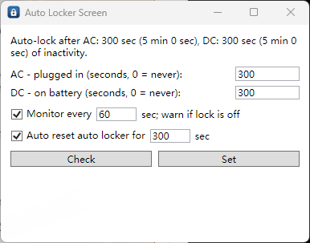

# auto_locker_screen_ex

WPF tool to check/set the Windows screen auto-lock (display off) timeout via powrprof.
Runs as a GUI with a tray icon, or as a CLI (`check_lock` / `set_lock`, see `-h`).

## Features

- **Check / Set**: read or set the AC (plugged in) and DC (on battery) screen-off
  timeouts in seconds (0 = never).
- **Monitor every N sec**: warns via a persistent topmost window while either
  timeout is <= 1s (effectively off); auto-closes once fixed.
- **Auto reset auto locker for N sec**: (requires Monitor) when a monitored timeout
  is 0, automatically sets it back to N seconds and pops a notification that
  auto-dismisses after 5 seconds.

Settings persist to `~/.config/auto_locker_screen_ex/config.json`.

## Rule

- Build via `build.ps1`, test via `test.ps1`. Both prompt for Debug/Release in the
  console (or take `-Configuration Debug|Release`). Do not invoke `dotnet build`
  directly for this folder.
- Deploy via `build.ps1 -Deploy [-DeployDir <path>]`: builds Release and copies the
  app files to the target dir (default `D:\auto_locker_screen_ex`), offering to kill
  a running instance there first and to start it after copying.
